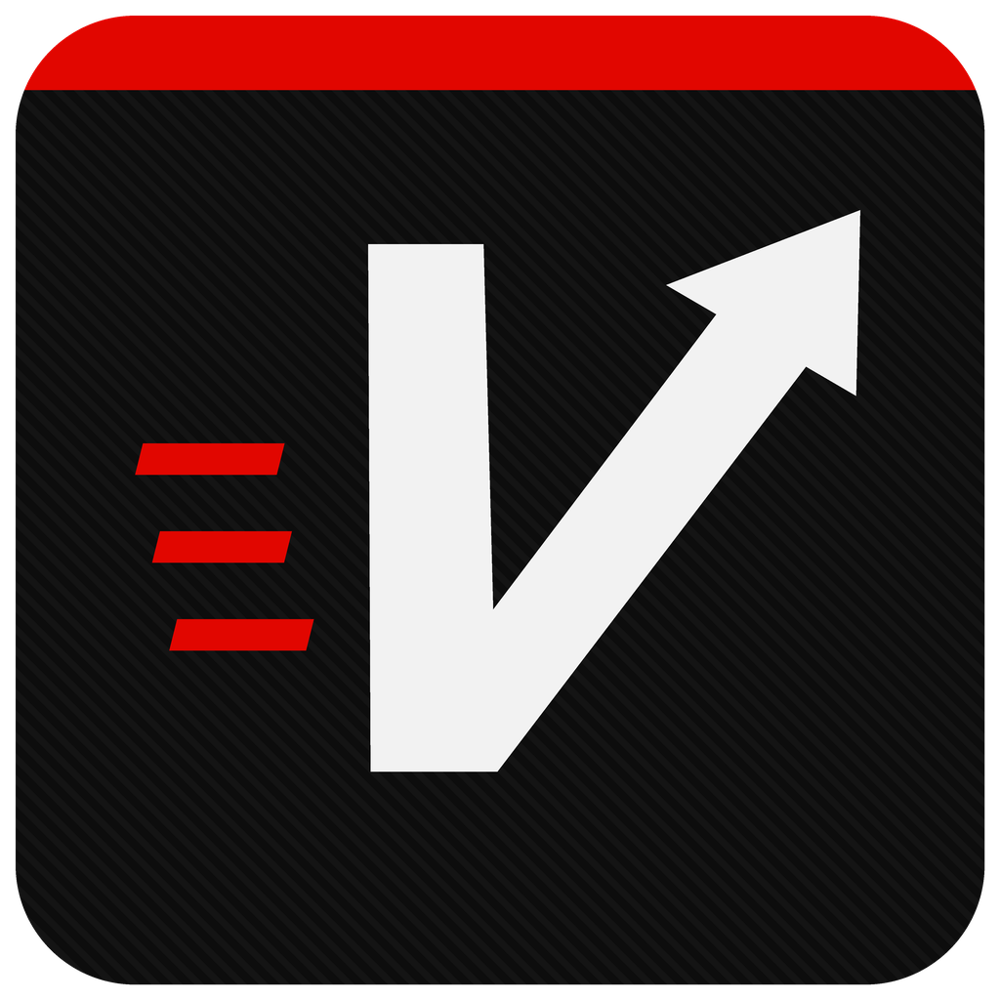
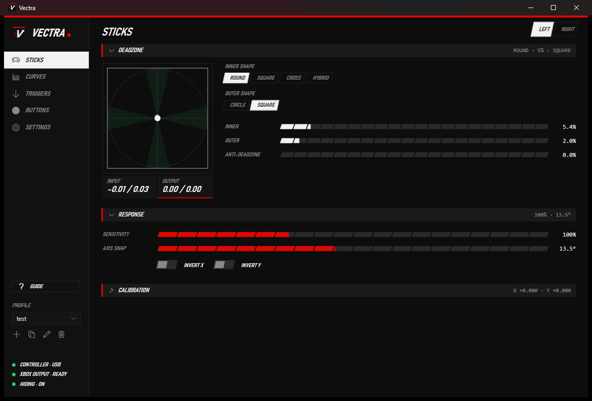
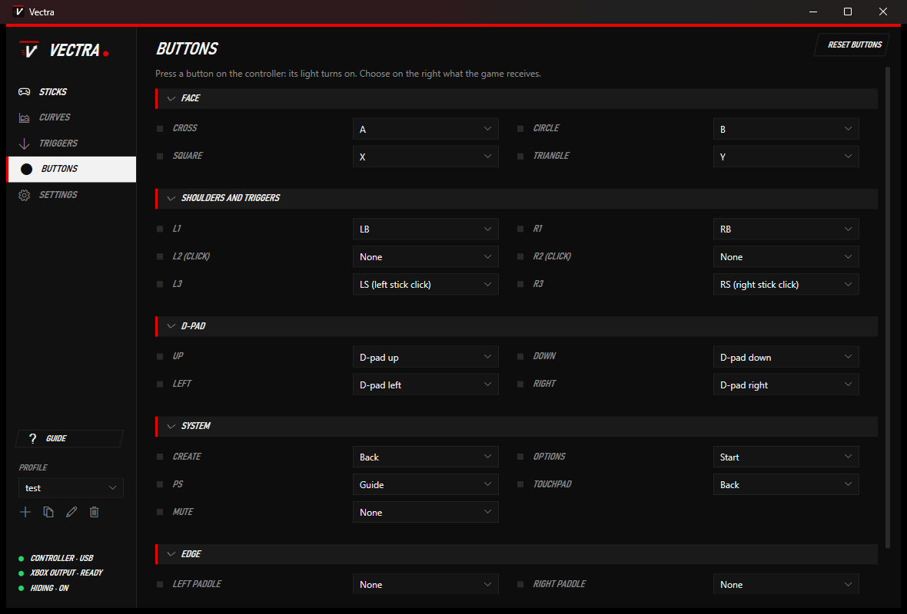
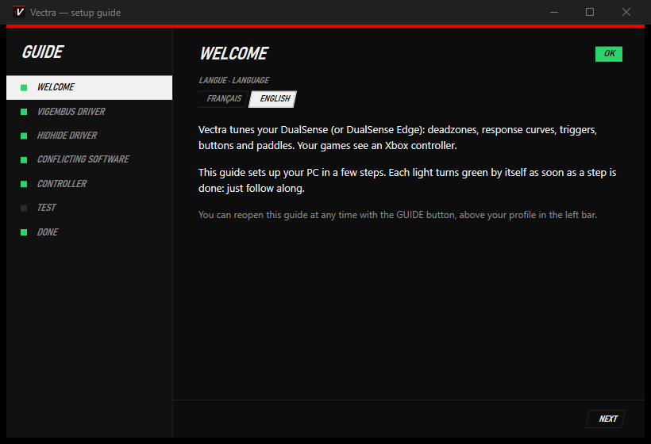

<p align="center"></p>

<h1 align="center">Vectra</h1>

<p align="center">
  DualSense / DualSense Edge controller tuning for Windows — deadzones (including <b>square</b>), response curves,
  triggers, button and paddle remapping, profiles. Games see a virtual Xbox 360 controller.
  <br><br>
  <a href="https://github.com/Valak2512/Vectra/releases/latest"><b>⬇ Download</b></a> ·
  <a href="#français">Français</a> · Free and open source (MIT)
</p>



## Features

- **Sticks** — inner deadzone (round, square, cross, hybrid), outer deadzone and shape (circle / square),
  anti-deadzone, sensitivity, axis snap with separate horizontal and vertical strength (locks onto up/down/left/right
  when you are close), invert, center calibration.
  Live view of what goes in and what comes out.
- **Curves** — editable response curve for each stick and trigger, with presets.
- **Triggers** — deadzone, outer zone and anti-deadzone for L2 / R2.
- **Buttons** — remap every button, including the DualSense Edge paddles and Fn buttons.
- **Profiles** — as many as you want, exported and imported as `.json` files to share them.
- **USB and Bluetooth**, real controller hidden from games (HidHide) so they only see one controller.
- **Setup guide** on first launch: installs the drivers, checks for conflicting software, tests the controller.
- English and French interface.

| | |
|---|---|
|  |  |

## Install

1. Download `Vectra.zip` from the [latest release](https://github.com/Valak2512/Vectra/releases/latest) and unzip it.
2. Run `Vectra.exe`. Nothing else to install beforehand (.NET is included).
   If Windows shows "Windows protected your PC", click **More info → Run anyway** (the app is not code-signed).
3. Follow the setup guide. It installs the two free drivers Vectra needs, with your permission:
   [ViGEmBus](https://github.com/nefarius/ViGEmBus) (virtual Xbox controller) and
   [HidHide](https://github.com/nefarius/HidHide) (hides the real controller from games).

Keep Vectra open while you play. Settings are stored in `%APPDATA%\DualTune`.

Windows 10/11 x64 only.

## Troubleshooting

- **The game sees two controllers, or Vectra's controller as player 2** — close other controller software
  (DS4Windows, reWASD, DSX…), including their background services, and turn off Steam Input for the game
  (right-click the game → Properties → Controller → Disable Steam Input).
- **The controller keeps disconnecting** — try another USB cable that carries data, on a port at the back of the PC.
- **A button is not recognized** — Settings → Diagnostics → Capture mode shows the raw bytes sent by the controller.

## Build from source

Requires the [.NET 8 SDK](https://dotnet.microsoft.com/download/dotnet/8.0).

```bash
dotnet run --project src/DualTune.App
dotnet test tests/DualTune.Tests
powershell -ExecutionPolicy Bypass -File tools/package.ps1
```

The last command creates `dist/Vectra.zip` (self-contained single-file exe). Pushing a `v*` tag builds it on
GitHub Actions and attaches it to a release.

## License

[MIT](LICENSE). Third-party components: see [THIRD-PARTY-NOTICES.md](THIRD-PARTY-NOTICES.md).

DualSense and PlayStation are trademarks of Sony Interactive Entertainment. Xbox is a trademark of Microsoft.
Vectra is an independent project and is not affiliated with or endorsed by them.

---

## Français

**Vectra** règle ta manette **DualSense / DualSense Edge** sur Windows : zones mortes (dont la zone **carrée**),
courbes de réponse, gâchettes, remapping des boutons et des palettes, profils. Les jeux voient une manette
Xbox 360 virtuelle. Gratuit et open source (licence MIT).

### Installation

1. Télécharge `Vectra.zip` depuis la [dernière version](https://github.com/Valak2512/Vectra/releases/latest)
   et dézippe-le.
2. Lance `Vectra.exe` — rien à installer avant (.NET est inclus). Si Windows affiche « Windows a protégé votre
   ordinateur », clique sur **Informations complémentaires → Exécuter quand même** (le logiciel n'est pas signé).
3. Suis le guide de démarrage : il installe les deux pilotes gratuits nécessaires (ViGEmBus et HidHide) et
   vérifie la manette.

Laisse Vectra ouvert pendant que tu joues. La langue (français / anglais) se change dans **Paramètres** ou sur la
première page du guide. Les réglages sont dans `%APPDATA%\DualTune`, et un profil peut être exporté puis importé
(fichier `.json`) pour le partager.

### En cas de souci

- **Le jeu voit deux manettes, ou celle de Vectra en 2ᵉ position** : ferme les autres logiciels de manette
  (DS4Windows, reWASD, DSX…), y compris leurs services en arrière-plan, et désactive Steam Input pour le jeu.
- **La manette se déconnecte** : essaie un autre câble USB (qui transfère les données), sur un port à l'arrière du PC.
- **Un bouton n'est pas reconnu** : Paramètres → Diagnostic → Mode capture.

### Compiler

Voir « Build from source » ci-dessus (SDK .NET 8).
